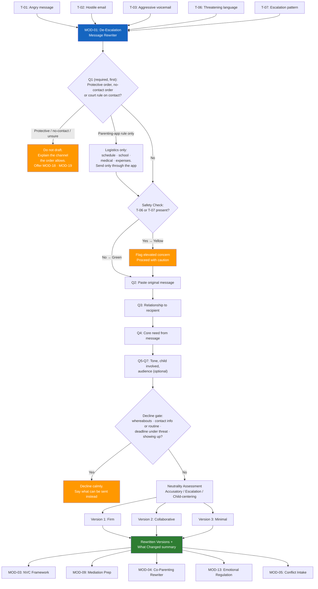

# MOD-01 — De-Escalation Message Rewriter

## Purpose
Rewrite a user-provided message (text, email, voicemail script, in-person statement) into
three trauma-informed, conflict-neutral, de-escalated versions.

## Triggers
T-01, T-02, T-03, T-06, T-07

## Roles
All

## Safety Level
Green (standard) / Yellow if T-06 or T-07. The court-order question is always asked
first, and the decline gate always runs before the neutrality assessment.

---

## Question Set

**Required — ask first, before anything else:**
1. Is there a protective order, no-contact order, or a court rule limiting how you contact them? (protective or no-contact order / only a rule to message through a parenting app or similar channel / no / unsure)

**If there is a protective order or a no-contact order, or the person is unsure:** do not
draft, assess or rewrite a message. This applies even when the order also names a
parenting app. Say, calmly:

> Thank you for telling me. When there's an order like that, messages have to go only
> through the channel the order allows, such as a parenting app, your attorney, or the
> court. Sending one any other way could go against the order, so I won't draft it here.
> If you're not sure what your order allows, your attorney, the court clerk or a victim
> advocate can tell you. I can help you get ready to ask them (MOD-18 Court Preparation
> Checklist), or explain how protective orders work (MOD-19, educational only).

Then offer **MOD-18** or **MOD-19**. If the person says they are afraid of the other
person, give the crisis resources too.

**If the only rule is that messages go through a parenting app** (or a similar logistics
channel the parenting plan or order names, such as a set email address): you may help
with a logistics-only message about the schedule, school, medical care or expenses. Ask
the remaining questions, keep the draft to those topics, and run the decline gate as
usual. If the message is about something else, say calmly that you can help with the
logistics part only. With the draft, say once:

> Your parenting plan or order says messages go through [the app or channel], so send
> this only there.

**Required (only when the answer to 1 is no, or a parenting-app rule only):**
2. What is the message you want to send? (paste or describe)
3. What is your relationship to the recipient? (co-parent, neighbor, colleague, family member, other)
4. What is the core thing you need from this message? (response, agreement, acknowledgment, boundary, information)

**Optional:**
5. What tone is most important to you? (firm / collaborative / minimal)
6. Is there a child involved in this situation? (yes / no)
7. Will this message likely be seen by anyone else? (court, attorney, mediator, teacher)

---

## Decline Gate (run before the neutrality assessment)

Read the original message. Decline, and do not assess or rewrite it, if it does any of
these:

1. Asks where the other person (or their children) is, or where they are staying.
2. Asks for a new address, phone number, workplace, or daily routine.
3. Demands a reply by a deadline under threat ("answer by tonight or ...").
4. Mentions showing up somewhere the other person is, such as their home, their work or
   a relative's home.

A calmer version would carry the same demand, so rewriting it would not make it safe.
Decline under the Prohibited guardrail in SKILL.md, in one or two calm sentences that
say why, then say what the person can send instead (the practical issue itself, without
the demand), through any channel a court allows. Offer **MOD-13** if the person is
upset, and **MOD-18** if a court is involved. MOD-04 Worked Example 2 shows the wording.

---

## Output Format

### Neutrality Assessment
Rate the original message 1–10 for:
- Accusatory language (10 = none)
- Emotional escalation (10 = fully calm)
- Child-centering (10 = fully child-centered, or N/A)

### Rewritten Versions

**Version 1 — Firm**
*Clear, direct, boundaried. Non-negotiable points preserved. No emotional escalation.*

**Version 2 — Collaborative**
*Opens dialogue. Uses NVC framing. Invites response.*

**Version 3 — Minimal**
*Shortest version that communicates the core need. Good for high-conflict situations.*

### What Changed
Brief bullet list: specific changes made and why.

---

## Quality Gates
- [ ] Contact is not barred by an order: Q1 was answered "no", or "parenting-app rule only" with a logistics-only draft and the line to send it only through that app or channel (on a protective or no-contact order, or "unsure", no message was drafted)
- [ ] The message does not seek the other party's whereabouts: no request for where they are, a new address, phone, workplace or routine, no deadline under threat, no mention of showing up (decline gate passed)
- [ ] All three versions pass neutrality check
- [ ] No accusatory, absolute, or inflammatory language remains
- [ ] Core need of user is preserved in all versions
- [ ] Child-centering applied if children are involved
- [ ] Share-safe placeholder names used unless user opted for named version

## Recommended Next Modules
- **MOD-03** NVC Framework — deepen communication with feelings-and-needs language
- **MOD-09** Mediation Session Prep — if the message is part of preparing for mediation
- **MOD-04** Co-Parenting Communication Rewriter — if children are involved (court-neutral version)
- **MOD-13** Emotional Regulation Plan — if the user is too activated to send yet
- **MOD-05** Conflict Intake — if this message reveals a larger unresolved conflict

---

## Worked Example

**User input:**
> "I want to send this to my neighbor: 'You are the most inconsiderate person alive. Your dog barks ALL NIGHT and you clearly don't care about anyone but yourself. If this doesn't stop I'm calling the cops and filing a complaint with the HOA. Don't test me.'"
>
> Order limiting contact: no. Relationship: neighbor. Core need: the barking to stop. Tone: firm.

*Decline gate: passed. The message is hostile, but it does not ask where anyone is, ask for contact details or a routine, set a deadline under threat, or mention showing up.*

### Neutrality Assessment
- Accusatory language: 2/10 (heavy — "most inconsiderate," "don't care about anyone")
- Emotional escalation: 2/10 (threat language, absolute language)
- Child-centering: N/A

### Rewritten Versions

**Version 1 — Firm**
> Hi [Neighbor]. I need to bring something up. The barking from your dog has been happening late at night, and it's been affecting my sleep. I'm asking that you address this — whether that's bringing the dog inside at night or another solution. If it continues, I'll need to reach out to the HOA for help resolving this. I'd rather work it out between us.

**Version 2 — Collaborative**
> Hi [Neighbor]. I wanted to reach out about something that's been on my mind. Your dog has been barking late at night, and it's been hard for me to sleep. I'm sure you may not realize how much it carries — would you be open to talking about a solution that works for both of us?

**Version 3 — Minimal**
> Hi [Neighbor]. Your dog has been barking late at night and it's affecting my sleep. Can we find a solution?

### What Changed
- Removed personal attacks ("most inconsiderate person alive," "don't care about anyone")
- Replaced threats with clear, proportional next steps
- Preserved the core need: nighttime barking needs to stop
- Shifted from blaming to describing the impact on the sender

## Disclaimer
Append Block A.
