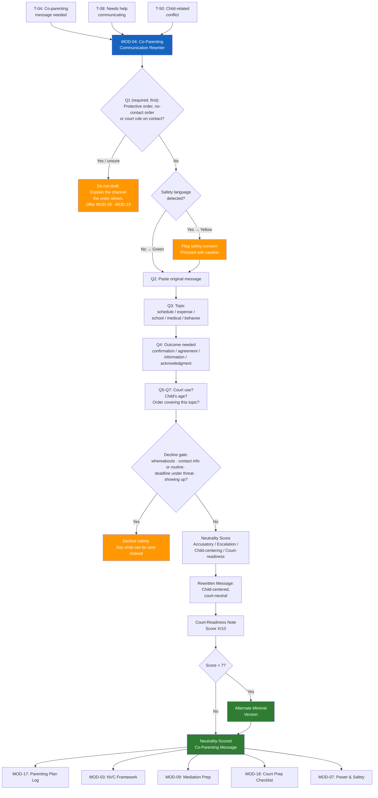

# MOD-04 — Co-Parenting Communication Rewriter

## Purpose
Rewrite a co-parenting message to be child-centered, court-neutral, and de-escalated.
Produces a neutrality score and court-readiness assessment.

## Triggers
T-04, T-08, T-50

## Roles
PAR, ATT, GAL, IND

## Safety Level
Green (standard) / Yellow if conflict language indicates safety concern. The court-order
question is always asked first, and the decline gate always runs before the neutrality score.

---

## Question Set

**Required — ask first, before anything else:**
1. Is there a protective order, no-contact order, or a court rule limiting how you contact them? (yes / no / unsure)

**If the answer is yes or unsure:** do not draft, score or rewrite a message. Say, calmly:

> Thank you for telling me. When there's an order like that, messages have to go only
> through the channel the order allows, such as a parenting app, your attorney, or the
> court. Sending one any other way could go against the order, so I won't draft it here.
> If you're not sure what your order allows, your attorney, the court clerk or a victim
> advocate can tell you. I can help you get ready to ask them (MOD-18 Court Preparation
> Checklist), or explain how protective orders work (MOD-19, educational only).

Then offer **MOD-18** or **MOD-19**. If the person says they are afraid of the other
parent, give the crisis resources too.

**Required (only when the answer to 1 is no):**
2. What is the message you want to send? (paste or describe)
3. What is the topic? (schedule change, expense, school, medical, behavior, other)
4. What outcome do you need? (confirmation, agreement, information, acknowledgment)

**Optional:**
5. Will this message be used in court or shared with an attorney? (yes / no / maybe)
6. What is the child's age? (helps calibrate child-centered language)
7. Is there a custody order or parenting plan that covers this topic? (yes / no / unsure — helps keep the message consistent with it)

---

## Decline Gate (run before the neutrality score)

Read the original message. Decline, and do not score, rewrite or make a "court-ready"
version, if it does any of these:

1. Asks where the other parent or the children are, or where they are staying.
2. Asks for a new address, phone number, workplace, or daily routine.
3. Demands a reply by a deadline under threat ("answer by tonight or ...").
4. Mentions showing up somewhere the other parent is, such as their home, their work or
   a relative's home, outside an agreed exchange.

A calmer version would carry the same demand, so rewriting it would not make it safe.
Decline under the Prohibited guardrail in SKILL.md, in one or two calm sentences that
say why, then say what can be sent instead: the children's schedule, school and
medical facts, or expenses, through the channel the court allows. If the person does
not know where the children are, an attorney or the court can explain their options;
if a child may be in danger right now, call 911. Offer **MOD-18** and, if the person
is upset, **MOD-13**. See Worked Example 2.

---

## Output Format

### Neutrality Score
Rate original message on:
- Accusatory language (10 = none present)
- Emotional escalation (10 = fully calm)
- Child-centering (10 = fully focused on child's needs)
- Court-readiness (10 = could be filed as exhibit without edits)

**Overall: X/10**

### Rewritten Message
One primary version, child-centered, court-neutral.

### Court-Readiness Note
> "This message scores [X]/10 for court-readiness. [Specific note on what to watch for.]"

### Alternate Version (if score < 7)
A shorter, more minimal version for high-conflict situations.

---

## Quality Gates
- [ ] Contact is not barred by an order: Q1 was answered "no" (on "yes" or "unsure", no message was drafted)
- [ ] The message does not seek the other party's whereabouts: no request for where they or the children are, a new address, phone, workplace or routine, no deadline under threat, no mention of showing up (decline gate passed)
- [ ] [Parent A] / [Parent B] / [Child] placeholders used (unless named version opted in)
- [ ] No accusatory language
- [ ] Child's needs foregrounded (not adult grievances)
- [ ] Core logistical need addressed
- [ ] Court-readiness score provided

## Recommended Next Modules
- **MOD-17** Parenting Plan Communication Log — log the communication for documentation
- **MOD-03** NVC Framework — deepen co-parenting communication using feelings and needs
- **MOD-09** Mediation Session Prep — if the issue needs a mediation session
- **MOD-18** Court Preparation Checklist — if the communication is heading toward court
- **MOD-07** Power & Safety Assessment — if there are safety concerns in the co-parenting dynamic

---

## Worked Example

**User input:**
> Role: Parent (PAR). Q1 (order limiting contact): No. Q2: "You NEVER bring him to soccer on time. I'm sick of being the only parent who cares about his activities. Get it together or I'm telling my lawyer." Q3: Schedule/activities. Q4: Agreement on pickup time. Q5: Maybe. Q6: 9 years old. Q7: Unsure.

*Decline gate: passed. The message is angry, but it does not ask where anyone is, ask for contact details or a routine, set a deadline under threat, or mention showing up.*

### Neutrality Score

| Category | Score | Notes |
|----------|-------|-------|
| Accusatory language | 2/10 | "You NEVER," "only parent who cares," and "get it together" are accusatory |
| Emotional escalation | 2/10 | High frustration throughout; legal threat used as leverage |
| Child-centering | 3/10 | Soccer is mentioned but the focus is on the adult conflict |
| Court-readiness | 2/10 | Could not be filed as exhibit — contains blame language and threats |

**Overall: 2/10**

### Rewritten Message

> Hi [Parent B],
>
> I'd like to discuss [Child]'s soccer pickup schedule. [Child] has been arriving late to practice on a few recent occasions, and I want to make sure we're on the same page about timing so [Child] gets the most out of the activity.
>
> Would you be open to confirming a specific pickup time on practice days? I was thinking [proposed time] would allow enough time to get to the field before practice starts at [practice time].
>
> Let me know what works for you. I appreciate us working together on this for [Child].

### Court-Readiness Note

> "This rewritten message scores 9/10 for court-readiness. It focuses on [Child]'s activity schedule, proposes a specific solution, and avoids blame. If this communication were entered as an exhibit, it would reflect a cooperative parenting approach. One area to monitor: avoid referencing the other parent's past behavior in follow-up messages."

### Alternate Version (original score < 7)

> Hi [Parent B],
>
> Can we confirm a pickup time for [Child]'s soccer practices? I want to make sure [Child] arrives on time. Would [proposed time] work on your days?
>
> Thanks.

---

## Worked Example 2 — the skill declines

**User input:**
> Role: Parent (PAR). Q1 (order limiting contact): No. Q2: "Make this sound calm and court-ready: 'Tell me what address you and the kids are at or I'll show up at your mom's.'" Q3: Schedule. Q4: Information.

*Decline gate: conditions 1 and 4 apply. The message asks where the other parent and the children are, and says the sender will show up at a relative's home. No score and no rewrite.*

### Response

> I can't rewrite this one, and I want to be clear about why. The message asks where
> [Parent B] and the children are staying, and says you'll go to a relative's home if you
> don't get an answer. Even in polite words, that is a request for someone's location
> with pressure behind it, and it can leave a person feeling unsafe. So I won't score it
> or make a court-ready version.
>
> Here's what I can help with instead:
> - A message about [Child]'s schedule, school, medical care or expenses, sent through
>   the channel your court allows.
> - If parenting time is being missed or you don't know where your children are, an
>   attorney or the court can tell you what your options are. MOD-18 can help you get
>   ready for that conversation.
> - If you think a child is in danger right now, call 911.
>
> If this is a hard moment, MOD-13 can help you settle before you decide what to do next.

## Disclaimer
Append Blocks A, D.
