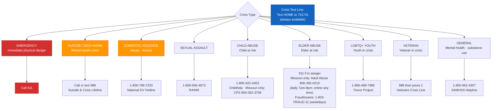

# Crisis Resources

## Always-Available Resources

*Last verified: 2026-10-18 (phone numbers and links checked against official sources).*

These resources are embedded in all Orange and Red safety gate outputs.
They are also available as an interrupt at any point in any session.

---

## National Crisis Lines

| Resource | Contact | Notes |
|----------|---------|-------|
| **988 Suicide & Crisis Lifeline** | Call or text **988** | 24/7. Press 2 for Spanish. TTY: dial 711, then 988. |
| **Crisis Text Line** | Text **HOME** to **741741** | 24/7. Text-based. |
| **National DV Hotline** | **1-800-799-7233** | 24/7. Chat: thehotline.org |
| **National Sexual Assault Hotline** | **1-800-656-4673** | 24/7. RAINN. |
| **Childhelp National Child Abuse Hotline** | **1-800-422-4453** | 24/7. |
| **National Elder Fraud Hotline** | **1-833-FRAUD-11** (1-833-372-8311) | DOJ. Monday–Friday, 10 a.m.–6 p.m. ET. |
| **Veterans Crisis Line** | Call **988**, then press **1** | Text: 838255. Chat: veteranscrisisline.net |
| **Trans Lifeline** | **877-565-8860** | Trans peer support. Not 24/7: weekdays 1–9 p.m. ET. Press 2 for Spanish. |
| **The Trevor Project (LGBTQ+ Youth)** | **1-866-488-7386** | Text: START to 678-678 |
| **SAMHSA National Helpline** | **1-800-662-4357** | Mental health & substance use. Free, confidential, 24/7. |

---

## Emergency

**If anyone is in immediate physical danger: Call 911.**

Access To Peace cannot replace emergency services. When in doubt, call 911.

---

## Missouri-Specific Resources (Reference Implementation)

*Missouri only. Outside Missouri, use the national lines above, childwelfare.gov/organizations (each state's child-abuse reporting line) and WomensLaw.org (state protective-order law and local DV programs).*

### Domestic Violence
| Organization | Contact |
|-------------|---------|
| National DV Hotline (serves Missouri) | 1-800-799-7233 |
| ALIVE (St. Louis) | 314-993-2777 |
| Safe Connections (St. Louis) | 314-531-2003 |
| Rose Brooks Center (Kansas City) | 816-861-6100 |

### Legal Aid
| Organization | Contact |
|-------------|---------|
| Legal Services of Eastern Missouri | 314-534-4200 · lsem.org |
| Missouri Legal Services (statewide legal aid portal) | lsmo.org |
| The Missouri Bar | 573-635-4128 (main) · Legal Resource line 573-636-3635 · LawyerSearch online at mobar.org |

### Mediation & Conflict Resolution
| Organization | Contact |
|-------------|---------|
| Missouri Bar Mediation Referral | mobar.org |
| Conflict Resolution Center (St. Louis) | 314-255-7449 · crcstl.org |

### Mental Health
| Organization | Contact |
|-------------|---------|
| Missouri Department of Mental Health | dmh.mo.gov · 573-751-4122 |
| NAMI Missouri | namimissouri.org · 573-634-7727 |
| Places for People (St. Louis) | 314-535-5600 |
| Behavioral Health Response (St. Louis) | 988 · 314-819-8811 |

### Child & Family
| Organization | Contact |
|-------------|---------|
| Missouri Children's Division (CPS) | 800-392-3738 |
| Missouri CASA | mocasa.org |
| St. Louis County Children's Services | 314-615-4900 |

### Youth
| Organization | Contact |
|-------------|---------|
| Missouri Division of Youth Services | dss.mo.gov/dys · 573-751-3324 |
| Youth In Need (St. Louis) | youthinneed.org · 636-946-3771 (24-hour) |
| Peter & Paul Community Services | ppcsinc.org · 314-588-7111 |

### Elder Services
| Organization | Contact |
|-------------|---------|
| Missouri Adult Abuse & Neglect Hotline | 800-392-0210 (daily 7 a.m.–8 p.m.; online any time at moapss.health.mo.gov). In danger now: call 911 first. |
| Missouri Attorney General Consumer Protection Hotline (scams, fraud) | 1-800-392-8222 |
| If money was taken | Call the bank or card company right away; report at reportfraud.ftc.gov (FTC) and, for internet or phone scams, ic3.gov (FBI) |
| National Elder Fraud Hotline | 1-833-FRAUD-11 (1-833-372-8311), weekdays |
| St. Louis Area Agency on Aging | 314-612-5918 |
| Legal Services of Eastern Missouri — elder law | lsem.org |

---

## National Service Finders

| Resource | URL | Use For |
|----------|-----|---------|
| 211 | 211.org or call **211** | Any social service referral |
| SAMHSA Treatment Locator | findtreatment.gov | Mental health & substance use treatment |
| LawHelp | lawhelp.org | Legal aid by state |
| DomesticShelters.org | domesticshelters.org | DV shelter finder |
| MentalHealth.gov | mentalhealth.gov | Federal mental health resources |
| ACF Child Care Finder | childcare.gov | Child care resources |

---

## How to Use This File

- **In Orange/Red sessions:** Include the top 3–4 most relevant resources in the artifact.
- **In Safety Plan artifacts (A-08):** Include full national list + state-specific list.
- **In Service Referral artifacts (A-10):** Filter by user's stated need and location.
- **As an interrupt:** Surface immediately on any crisis trigger (T-71 through T-80).

---

## Localization Note

Missouri is the reference implementation. To deploy for another state:
1. Fork this file.
2. Replace the state-specific section with your state's resources.
3. Maintain all national resources — they do not change.
4. Update `references/legal-disclaimer.md` to reflect your state's legal aid organizations.
